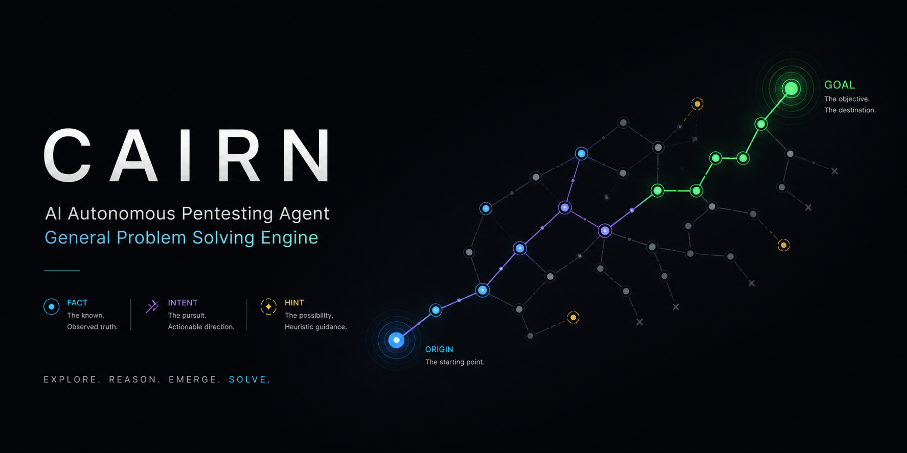
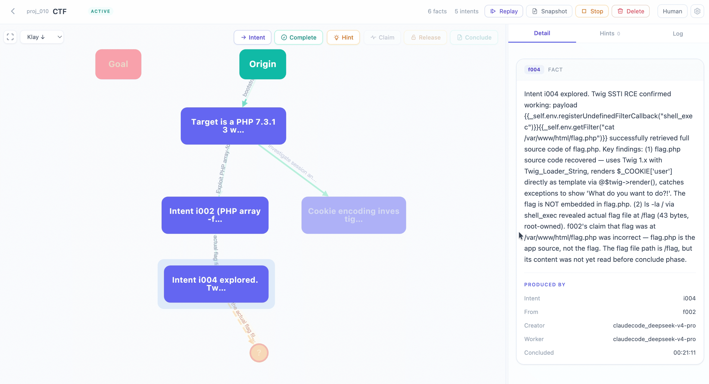

<div align="center">



# Frex
### More Than Just AI Penetration Testing — Towards General State-Space Search

<p>
  
  
</p>

Frex is a general-purpose problem-solving engine. <br/>It defines no roles, no workflows. Given an origin and a goal, it searches for a path through an unknown state space. <br/>AI Penetration Testing is one such problem — and a proven one.

> **Frex** is a renamed and extended derivative of **Cairn** (upstream author: leixiao).
> The upstream project's results and artwork are retained for attribution; the
> v0.3/v0.4 runtime, evidence, operations, and benchmark work described below is
> this fork's.

<p>
  <a href="https://discord.gg/nDSy4NZVP" target="_blank" rel="noopener noreferrer">
    
  </a>
  <a href="https://x.com/le1xia0" target="_blank" rel="noopener noreferrer">
    
  </a>
</p>

</div>

<p align="center">
  <a href="https://www.bilibili.com/video/BV1a8R5BhEVi/" target="_blank" rel="noopener noreferrer">
    
  </a>
</p>

## What is Frex?

Penetration testing is fundamentally a **directed search through a near-infinite state space**:

- **Origin**: known (target IP, target system)
- **Goal**: defined (get a shell, capture the flag)
- **Path**: unknown

This structure is not unique to penetration testing. Vulnerability research, mathematical proof, CTF challenges — any problem with a clear starting point, a clear success condition, and an unknown path in between shares the same shape.

Frex is built for this class of problems. Penetration testing is the first domain it has been validated on.

The engine is built on a **Blackboard Architecture** with an explicit fact-intent graph. Three primitives are all it needs:

| Concept | Meaning |
|---------|---------|
| **Fact** | A confirmed, objective finding written to the board |
| **Intent** | A declared direction of exploration, not yet executed |
| **Hint** | Human judgment injected at any time; absorbed by agents on the next read |

The graph grows from `origin` toward `goal`. Every new Fact is a stepping stone; every Intent is a step into the unknown.

Agent Workers run an OODA loop — Observe the full graph, Orient to the current state, Decide on next intents, Act to explore — and write their findings back as new Facts. Workers have no fixed roles. Tasks are generated at runtime from the graph's current state, not from predefined job descriptions.

Agents coordinate exclusively through the shared board (Stigmergy). No direct communication. No information silos.

## Frex in Action

https://github.com/user-attachments/assets/e557b1ac-dda4-41cb-87dd-9d56dbf05133


## How It Works

Three task types, all executed by the same Worker:

| Task | What it does | Output |
|------|-------------|--------|
| **Bootstrap** | At project start, attempts to solve the problem directly | Fact + possible Complete |
| **Reason** | Reads the full graph: is the goal met? What should be explored next? | Complete / new Intents / no-op |
| **Explore** | Claims one Intent, executes the exploration, reports findings | One Fact |

System architecture:

```
          ┌──────────────────────────────────┐
          │           Frex Server           │
          │    Facts + Intents + Hints       │
          └─────────────────┬────────────────┘
                            │
                     Read / Write API
                            │
          ┌─────────────────┴────────────────┐
          │             Dispatcher           │
          │   Schedules tasks, manages       │
          │   containers, writes protocol    │
          └──────────┬───────────────┬───────┘
                     │               │
     ┌───────────────┴──┐     ┌──────┴──────────────┐
     │  Worker Container│     │  Worker Container   │
     │   (Project A)    │     │   (Project B)       │
     │  ┌────┐  ┌────┐  │     │  ┌────┐  ┌────┐     │
     │  │ W. │  │ W. │  │     │  │ W. │  │ W. │     │
     │  └────┘  └────┘  │     │  └────┘  └────┘     │
     └──────────────────┘     └─────────────────────┘
```

**Frex Server** maintains graph consistency only.

**Frex Dispatcher** reads the graph, schedules tasks, spins up and tears down worker containers, and is the sole writer to the protocol. Each project gets its own Worker Container; multiple Agent Workers run concurrently inside it. Agent Workers only receive a prompt and return structured output.

Supported worker backends: **Claude Code**, **Codex**, and **Pi**.

## Upstream results (Cairn)

These are the original Cairn project's competition results, reproduced for
attribution — not benchmark results for Frex.

**Tencent Cloud Hackathon · AI Penetration Testing Challenge · 2nd Edition**

610 teams · 1,345 participants · top universities and security firms across China

| Metric | Value |
|--------|-------|
| Problems solved | **54 / 54 — only team to AK** |
| Final ranking | 3rd |

> The system had never been tested before the competition. The full pipeline came online for the first time at 4 AM on race day. No training, no tuning, no domain-specific tooling. Zero MCP tools, zero RAG, zero predefined agent roles.

## Status (v0.4)

Frex v0.4 is a realtime red teaming engine. What is in the tree today
(each verifiable in the repo, not narrative):

- **Evidence & verification** — facts carry kind/status/confidence;
  agent claims start as hypotheses and only verification flips them.
  See `docs/en/adr/002-evidence-model.md`.
- **Provider layer** — models are configuration, not images. One
  `openai_compat` adapter covers vLLM/Ollama/llama.cpp; routing falls
  through unhealthy models. See `docs/en/adr/001-provider-layer.md`.
- **Native agent runtime** — the dispatcher runs the model loop with
  container tools, budgets, steering, and SSE streaming end-to-end.
  See `docs/en/adr/003-native-runtime.md` and `docs/en/native-runtime.md`.
- **Operations layer** — scope guard, risk approval gate, budget
  ceilings, resource locks, encrypted secret refs, and tool-output
  ingestors (`frex ingest`).
- **Benchmark harness** — `frex/bench/` runs lab scenarios with a
  referee-verified goal and compares models on time-to-goal, verified
  facts, and cost.

Verified live on 2026-11-27: native explore ran through an
OpenAI-compatible gateway (9router) routed to the open-weight model
`oc/hy4-flash-free`. The model executed `echo FREX_LIVE_OK` in a
`python:3.12-slim` container, completed in 2 steps (6577 tokens in, 105
out), and concluded fact `f001` with `run_006`. Details and the exact
event sequence are in `docs/en/native-runtime.md#live-verification-2026-11-27`.

A real benchmark ran on 2026-11-27: local DVWA lab, two free
open-weight models via the 9router gateway, both reached verified
`uid=33(www-data)` command execution — `oc/hy4-flash-free` in 130 s
(130k/2.5k tokens) and `sn/glm-5.3-flash:flex` in 436 s (246k/5.6k
tokens), one run each, not a statistical comparison. Numbers and
caveats: `frex/bench/README.md`.

Container E2E against the upstream worker image passed locally on
2026-11-27; CI keeps it opt-in via `FREX_E2E=1` because the image is
15 GB. The container workflow also built and published
`ghcr.io/net1nfect/frex-worker-container:latest` (anonymous pull
verified); the E2E run above used the upstream image. Not yet:
self-hosted vLLM/Ollama directly in the loop. Claims beyond this list
should not be assumed.

## Documentation

English docs in `docs/en/`, Indonesian versions in `docs/id/`; ADRs in
`docs/en/adr/`.

## Further Reading

- <a href="https://mp.weixin.qq.com/s/DlpEH7bVr0xi0VawPJs3XA" target="_blank" rel="noopener noreferrer">The Strongest AI Penetration Testing Agent: Postmortem of the Only Team to Achieve AK at the TCH Tencent Cloud Hackathon Intelligent Penetration Testing Challenge (2nd Edition)</a>
- <a href="https://mp.weixin.qq.com/s/2rEqFLvkxvYWM3gW170C2w" target="_blank" rel="noopener noreferrer">The Pathless Path: Cairn AI from Penetration Testing to General Problem Solving</a>


## Getting Started

**Prerequisites**
 
- macOS or Linux
- Python ≥ 3.12
- Docker


### Pull required images
 
Both setup methods require the worker container image:
 
```bash
docker pull --platform=linux/amd64 ghcr.io/oritera/cairn-worker-container:latest
```

The container workflow also publishes an image built from this repo's
`container/Dockerfile`: `ghcr.io/net1nfect/frex-worker-container:latest`.
`dispatch.yaml` still defaults to the upstream image for compatibility.
 
### Docker Compose (recommended)
 
Pull the base image used to build Frex:
 
```bash
docker pull ghcr.io/astral-sh/uv:python3.13-trixie
```
 
Edit `dispatch.yaml` and fill in your LLM endpoints and API keys, then start both services:
 
```bash
docker compose up --build
```
 
This starts `frex-server` on port `8000` and `frex-dispatcher` once the server passes its health check. The dispatcher mounts `dispatch.yaml` from the project root and connects to Docker via the host socket. Data is persisted to `./datas/frex/`.
 
### Securing the API (optional)

The API is open by default. To require a bearer token on every request,
set the same variable on both sides:

```bash
export FREX_API_TOKEN="$(openssl rand -hex 32)"   # server
export FREX_API_TOKEN="<same token>"              # dispatcher
```

See `docs/dev/auth.md` for rotation and UI behaviour.

### Backing up before upgrading

Frex migrates its sqlite database automatically on server start
(`schema_version` currently at 3). The migration is transactional, but a
backup is still cheap insurance:

```bash
cp ~/.local/share/frex/frex.db ~/.local/share/frex/frex.db.bak
```

### Trusting agent claims

Facts are hypotheses until something verifies them. The dispatcher can
replay evidence in a fresh container and flip statuses automatically —
see `docs/dev/evidence-verify.md · docs/dev/native-runtime.md`. Schema v4 migrates automatically on
server start.

### Manual
 
Edit `dispatch.yaml` and fill in your LLM endpoints and API keys, then:
 
```bash
# Start the server
uv run --project frex frex serve
 
# Run the dispatcher
uv run --project frex frex dispatch --config dispatch.yaml
 
# Run startup health checks only
uv run --project frex frex dispatch --config dispatch.yaml --startup-healthcheck-only
```

## Disclaimer

Frex is a general-purpose problem-solving engine. Although it supports penetration testing, CTF solving, security assessment, and vulnerability research workflows, it is intended to be used only in environments where you have explicit authorization to operate.

You are solely responsible for how you use this project. Do not use Frex against systems, networks, applications, or data without clear prior permission from the owner or operator. Unauthorized security testing, exploitation, or data access may be illegal and may cause harm.

The developers and contributors of this project do not endorse or accept responsibility for any misuse, abuse, damage, loss, or legal consequences arising from its use. By using this project, you agree to ensure that your activities comply with all applicable laws, regulations, contractual obligations, and professional or organizational policies in your jurisdiction.


## ⚖️ License
This project is licensed under **GNU AGPLv3** for personal and educational use.

**Commercial Use**: If you wish to use this project in a commercial or proprietary environment without the AGPL-3.0 open-source obligations, **please contact me to obtain a commercial license.**

**Contributions**: By submitting a Pull Request, you agree that your contributions may be used under both the AGPL-3.0 and the project's commercial license.
